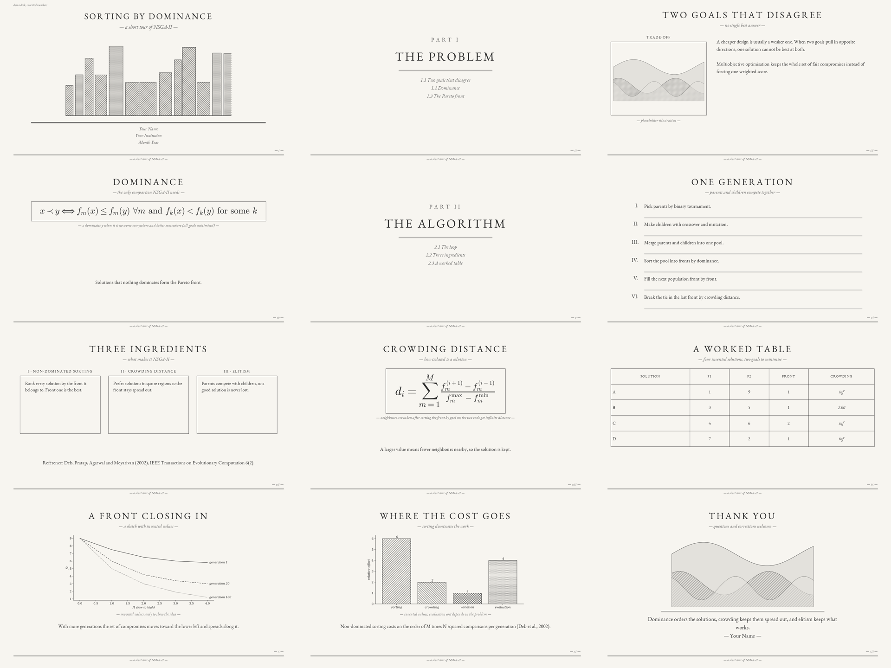

# etching-ppt

A skill and a small Python toolkit for building PowerPoint decks in a calm, monochrome "etching" style: warm paper,
pen-and-ink illustrations, spaced-caps serif titles, Roman-numeral labels, thin rules.



Open [`examples/demo.pdf`](examples/demo.pdf) to read the demo deck without PowerPoint or the font.

This folder works in two ways:

- as an **agent skill**: `SKILL.md` tells an AI coding agent when to use the style and how to produce a deck;
- as a **library and CLI**: write a JSON spec, run one command, get a `.pptx`.

## Quick start

```bash
pip install -r requirements.txt
python scripts/build_deck.py examples/demo_spec.json -o demo.pptx
python scripts/render_check.py demo.pptx -o preview/
```

Install the free font [EB Garamond](https://fonts.google.com/specimen/EB+Garamond) first, or set `"font": "Georgia"`
in the spec.

## Use it as a skill

Agents that read `SKILL.md` with YAML front matter can load this folder directly.

| Agent | How |
|---|---|
| Claude Code | copy the `etching-ppt/` folder to `~/.claude/skills/etching-ppt/` (personal) or `.claude/skills/etching-ppt/` (project) |
| Other agents (Codex, Cursor, Gemini CLI, and so on) | point the agent at `SKILL.md`, or paste its contents into the agent's rules or instructions file; the scripts are plain Python |

Then ask for something like: "Make a 12-slide deck about X in the etching style", and give it your outline or source
text. The agent writes a spec, builds, renders and checks the slides.

## Layout

```
SKILL.md                    instructions for the agent
scripts/etching_kit.py      the library: Deck class, layouts, equation and chart helpers
scripts/build_deck.py       JSON spec to .pptx
scripts/render_check.py     .pptx to PNG previews (PowerPoint on Windows, or LibreOffice)
references/design.md        the full style specification
references/layouts.md       every layout and its fields
references/illustration_prompts.md   prompts for generating matching illustrations
examples/demo_spec.json     a ten-slide demo using every layout
```

## Requirements

Python 3.9 or later; `python-pptx`, `matplotlib`, `Pillow`, `numpy`. For previews: PowerPoint (Windows) or
LibreOffice plus `PyMuPDF`.

## Notes

- The deck stores the font name only; the presenting machine needs the font installed, or export to PDF.
- Illustrations are not bundled. `placeholder:` images are procedural stand-ins for layout testing.
- Equations use matplotlib mathtext, which covers most LaTeX math but not full environments such as `align`.

## License

MIT, see `LICENSE`.
